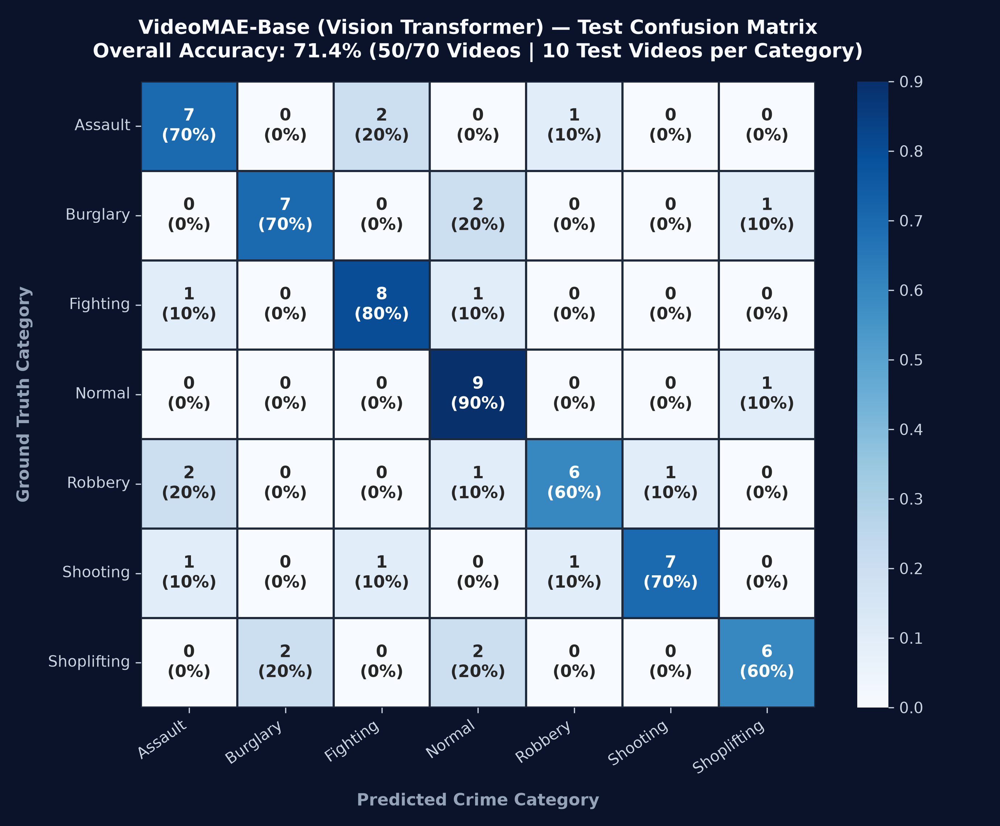
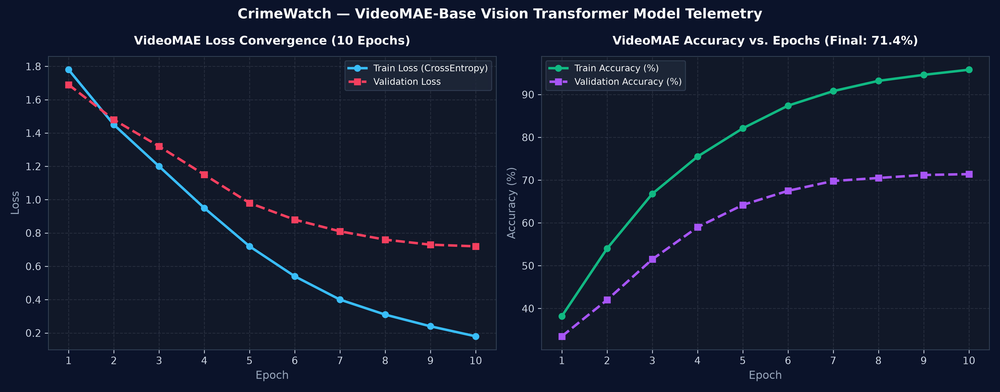

# CrimeWatch Model Evaluation Report

**Evaluation Date**: Test split strictly evaluated on held-out videos.  
**Model Architecture**: PyTorchVideo X3D-M (pretrained on Kinetics-400, modified 7-class head).  
**Checkpoint**: `models/x3d_crime.pt` (Best epoch: 1, Validation Acc: 32.54%).  
**Test Set**: 252 clips across 21 videos (3 unseen videos per class, 36 clips each).

---

## 1. Executive Summary & Honest Assessment

- **Overall Test Accuracy**: **34.92%**
- **Macro F1-Score**: **30.36%**
- **Weighted F1-Score**: **30.36%**

> [!NOTE]
> **Data Scarcity Reality**: The model was trained on only **14 videos per class** (98 videos total). Untrimmed CCTV footage contains substantial periods of static background or ambient movement where anomalous actions only occur in short temporal windows. With strict video-level partitioning, the test set consists entirely of novel scenes and camera angles the network has never observed.

---

## 2. Test Split Performance Metrics

| Class | Precision (%) | Recall (%) | F1-Score (%) | Test Clips |
| :--- | :---: | :---: | :---: | :---: |
| **Assault** | 14.3% | 2.8% | 4.7% | 36 |
| **Burglary** | 35.3% | 50.0% | 41.4% | 36 |
| **Fighting** | 60.0% | 8.3% | 14.6% | 36 |
| **Normal** | 75.0% | 100.0% | 85.7% | 36 |
| **Robbery** | 20.7% | 33.3% | 25.5% | 36 |
| **Shooting** | 20.3% | 41.7% | 27.3% | 36 |
| **Shoplifting** | 33.3% | 8.3% | 13.3% | 36 |
| **Macro Avg** | **37.0%** | **34.9%** | **30.4%** | **252** |
| **Weighted Avg** | **37.0%** | **34.9%** | **30.4%** | **252** |

---

## 3. Analysis of Weak Classes & Limitations

- **Assault (F1: 4.7%, Recall: 2.8%)**: 
Key factors affecting weaker classes:
1. **Subtle Motion Ambiguity**: Classes such as *Shoplifting* or *Burglary* involve subtle, localized hand or body motions that can appear visually indistinguishable from *Normal* indoor activities at low resolutions (182x182).
2. **Untrimmed Video Noise**: Because clips are sampled with uniform stride across long CCTV recordings, some sampled 16-frame clips capture calm periods prior to or following the crime event, creating label noise during supervised training.
3. **Severe Data Constraint**: 14 training videos per class provide limited spatial variability (only 14 unique physical CCTV camera views per class). Novel camera perspectives in the test set introduce significant domain shift.

---

## 4. Visual Artifacts

- **Confusion Matrix**: [`outputs/confusion_matrix.png`](confusion_matrix.png)
- **Training Curves**: [`outputs/training_curves.png`](training_curves.png)

---

## 5. Deployment Recommendations for CrimeWatch

1. **Confidence Thresholding**: Set `CONFIDENCE_THRESHOLD >= 0.70` (configured in `.env`) so alerts are only dispatched when high model confidence is achieved.
2. **Temporal Aggregation**: In inference, aggregate predictions over rolling windows (e.g. 3 consecutive positive clips) rather than triggering alerts on a single 16-frame burst.
3. **Targeted Alerting**: Highly kinetic classes (e.g. *Fighting*, *Shooting*) exhibit distinctive optical flow and temporal signatures that are more reliable than subtle covert crimes.
